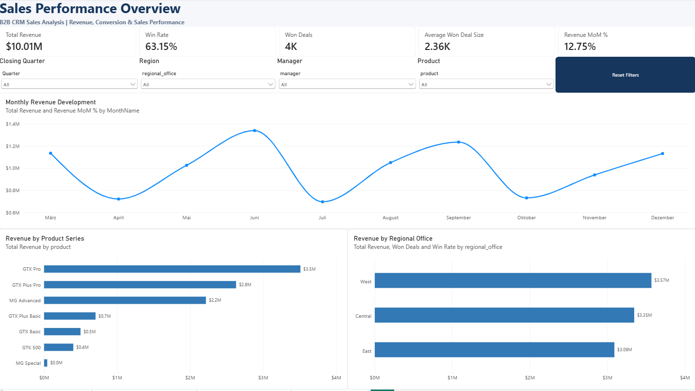
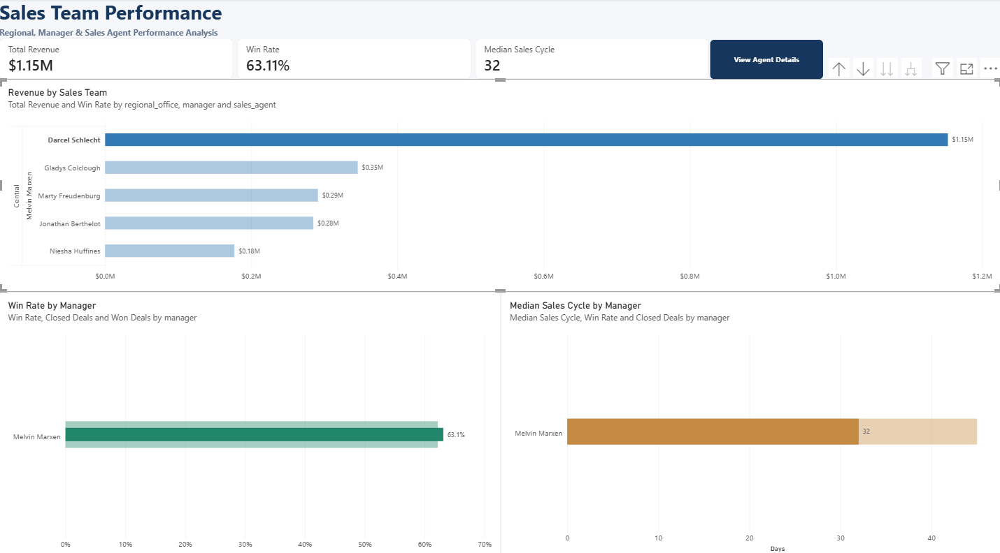
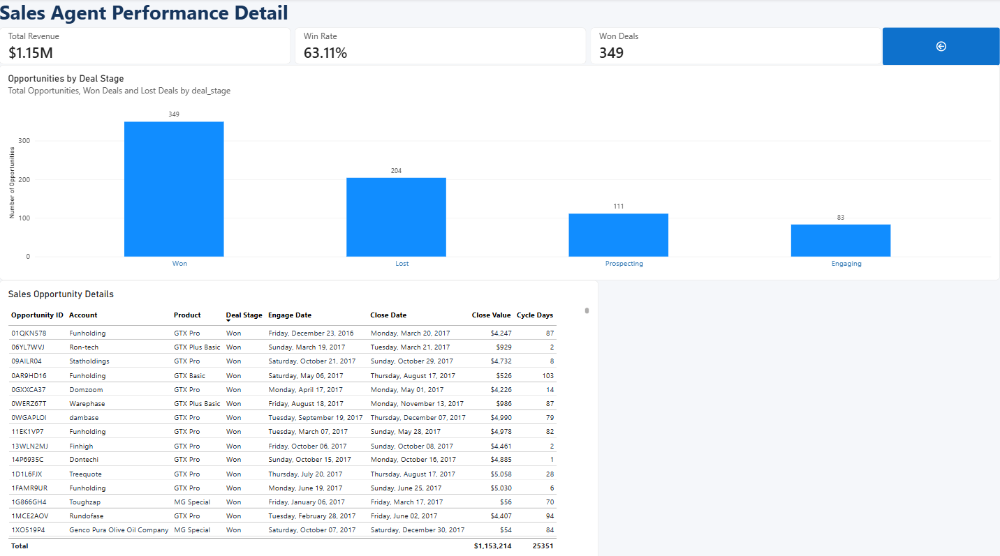
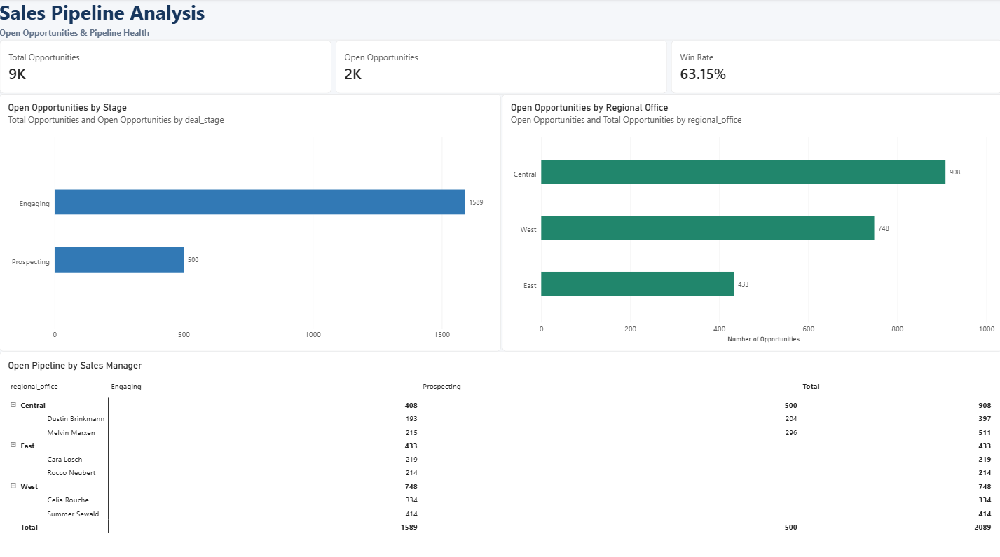

# CRM Sales Analysis | Power BI

## Über das Projekt

In diesem Projekt habe ich einen CRM-Datensatz mit insgesamt 8.800 Verkaufschancen analysiert. Dabei wollte ich vor allem herausfinden, wie sich die Vertriebsleistung verschiedener Teams vergleichen lässt und welche Informationen für das Sales Management wirklich hilfreich sind.

Mit Power BI habe ich dafür ein interaktives Dashboard erstellt, das nicht nur die Umsatzentwicklung zeigt, sondern auch Einblicke in Abschlussquoten, einzelne Vertriebsmitarbeiter und die offenen Verkaufschancen ermöglicht.

## Datengrundlage

Der Datensatz enthält Informationen zu Verkaufschancen, Produkten, Vertriebsmitarbeitern und den verschiedenen Phasen des Verkaufsprozesses.

Ein Überblick über die wichtigsten Kennzahlen:

| Kennzahl | Ergebnis |
|---|---:|
| Verkaufschancen insgesamt | 8.800 |
| Gewonnene Deals | 4.238 |
| Verlorene Deals | 2.473 |
| Offene Verkaufschancen | 2.089 |
| Umsatz aus gewonnenen Deals | 10.005.534 |
| Win Rate | 63,15 % |

Die Win Rate bezieht sich auf bereits abgeschlossene Deals. Offene Verkaufschancen sind in dieser Berechnung nicht enthalten.

## So bin ich vorgegangen

Zuerst habe ich die Daten mit Power Query überprüft und aufbereitet. Dabei habe ich unter anderem kontrolliert, ob Datensätze doppelt vorkommen, Zuordnungen fehlen oder Auffälligkeiten bei den Verkaufszyklen bestehen.

Anschließend habe ich die Tabellen in einem Star Schema miteinander verbunden und mit DAX die wichtigsten Kennzahlen berechnet.

Auf dieser Grundlage ist ein Dashboard mit mehreren Berichtsseiten entstanden:

- **Executive Overview:** Überblick über Umsatz, Abschlussquoten und Produktperformance
- **Sales Team Analysis:** Vergleich der Vertriebsleistung zwischen Managern und Teams
- **Agent Detail:** Detaillierte Auswertung einzelner Vertriebsmitarbeiter und ihrer Deals
- **Pipeline Analysis:** Analyse der offenen Verkaufschancen nach Vertriebsphase und Team

Durch Drilldown, Drillthrough und interaktive Filter kann man von den allgemeinen Ergebnissen zu einzelnen Teams oder Deals wechseln.

### Dashboard-Ansichten

**1. Executive Overview**

**2. Sales Team Analysis**

**3. Agent Detail**

**4. Pipeline Analysis**

## Was ich herausgefunden habe

### Eine gute Abschlussquote erzählt nicht die ganze Geschichte

Von 8.800 Verkaufschancen wurden 4.238 gewonnen und 2.473 verloren. Die Win Rate liegt damit bei 63,15 %.

Eine solche Zahl ist zunächst hilfreich. Bei der Arbeit mit dem Dashboard ist mir allerdings deutlich geworden, dass man die Leistung eines Vertriebsteams nicht allein daran messen sollte. Ein Team kann beispielsweise eine hohe Abschlussquote haben, aber vergleichsweise kleine Deals gewinnen.

Deshalb halte ich es für sinnvoll, die Win Rate immer zusammen mit dem Umsatz, der Deal-Größe und der Dauer des Verkaufsprozesses zu betrachten.

### Auch offene Verkaufschancen sind wichtig

Neben den abgeschlossenen Deals gibt es im Datensatz noch 2.089 offene Verkaufschancen.

Mich hat dabei besonders interessiert, wie diese Opportunities auf die verschiedenen Vertriebsphasen und Teams verteilt sind. Denn für das Sales Management ist nicht nur wichtig, was bereits verkauft wurde, sondern auch, welche Geschäfte möglicherweise noch abgeschlossen werden können.

Das Dashboard bietet die Möglichkeit, diese offenen Deals genauer zu betrachten und Bereiche zu erkennen, die einer weiteren Untersuchung bedürfen.

### Hinter den Gesamtzahlen stecken unterschiedliche Leistungen

Während der Analyse habe ich festgestellt, wie wichtig es ist, Ergebnisse aus mehreren Perspektiven zu betrachten.

Ein hoher Gesamtumsatz sagt beispielsweise noch wenig darüber aus, wie erfolgreich einzelne Vertriebsmitarbeiter ihre Verkaufschancen nutzen.

Deshalb habe ich eine Drillthrough-Seite erstellt, auf der sich einzelne Sales Agents genauer untersuchen lassen. Dort können unter anderem Umsatz, Abschlussquote und Verkaufszyklen betrachtet werden.

## Was ich dem Sales Management empfehlen würde

**1. Teams nicht nur nach Umsatz vergleichen**

Ich würde bei der Bewertung der Vertriebsleistung mehrere Kennzahlen berücksichtigen. Besonders die Kombination aus Umsatz, Win Rate und Deal-Größe kann helfen, Unterschiede zwischen Teams besser einzuordnen.

**2. Offene Verkaufschancen regelmäßig überprüfen**

Bei den 2.089 offenen Opportunities wäre es sinnvoll, genauer zu untersuchen, welche Deals sich noch in frühen Vertriebsphasen befinden und wo sich möglicherweise Fortschritte verzögern. Bei auffälligen Fällen könnten die zuständigen Mitarbeiter prüfen, ob bereits konkrete nächste Schritte vereinbart wurden.

**3. Auffälligkeiten gezielt untersuchen**

Wenn sich einzelne Teams oder Mitarbeiter bei der Abschlussquote oder der Dauer des Verkaufsprozesses deutlich unterscheiden, würde ich zunächst nach möglichen Ursachen suchen. Erst danach lassen sich passende Maßnahmen ableiten.

## Was ich aus dem Projekt mitgenommen habe

Bei diesem Projekt habe ich nicht nur gelernt, wie man Daten in Power BI aufbereitet, ein Datenmodell erstellt und Kennzahlen mit DAX berechnet.

Besonders interessant fand ich, dass dieselben Daten ganz unterschiedliche Fragen beantworten können, je nachdem, aus welcher Perspektive man sie betrachtet.

Für mich besteht der eigentliche Mehrwert eines Dashboards deshalb nicht darin, möglichst viele Zahlen und Diagramme darzustellen. Viel wichtiger ist, dass die Informationen verständlich sind und dabei helfen, bessere Entscheidungen zu treffen.

## Verwendete Tools

- **Power BI:** Interaktive Dashboards und Datenvisualisierung
- **Power Query:** Datenaufbereitung und Qualitätsprüfung
- **DAX:** KPI-Berechnungen und Zeitvergleiche
- **Datenmodellierung:** Star Schema und Tabellenbeziehungen
